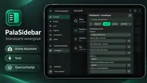
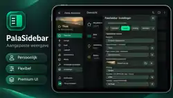
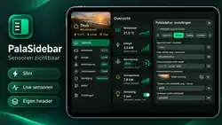

# PalaSidebar

**Een persoonlijke, moderne zijbalk voor Home Assistant.** Richt je dashboards, menu's, live sensorbadges en vormgeving zelf in — op desktop, telefoon en tablet.

[**Installeren**](#installeren) · [**Zo werkt het**](#zo-werkt-het) · [**Versies**](#versies-en-releases) · [**Bijwerken**](#bijwerken-en-terugzetten) · [**Hulp**](#hulp-en-problemen)

<p align="center">
  <a href="docs/images/palasidebar-standaard-groot.png"></a>
  <a href="docs/images/palasidebar-aangepast-groot.png"></a>
  <a href="docs/images/palasidebar-sensoren-groot.png"></a>
</p>

<p align="center"><sub>Klik op een voorbeeld om het groter te bekijken. De weergave is afhankelijk van je Home Assistant-thema en instellingen.</sub></p>

## Installeren via de ingebouwde Marketplace (Home Assistant 2026.11+)

Vanaf **Home Assistant 2026.11** is de vroegere HACS-functionaliteit standaard ingebouwd als **Marketplace**. Je hoeft HACS niet meer apart te downloaden of als integratie te installeren. PalaSidebar blijft een **community-integratie**, geen standaardonderdeel van Home Assistant.

1. Open als beheerder **Instellingen → Marketplace** en accepteer bij het eerste gebruik de waarschuwing over communitysoftware.
2. Zoek naar **PalaSidebar**. Staat de repository niet in de catalogus? Kies rechtsboven **Toevoegen via link** (*Add from link*).
3. Vul bij **GitHub-link** `https://github.com/OnlyRobin/PalaSideBar` in en kies **Toevoegen**. Koppel je GitHub-account via de aangeboden apparaatcode als Marketplace daarom vraagt. Kies het type **Integratie** als dit niet automatisch wordt herkend.
4. Open **PalaSidebar** in de Marketplace, kies **Installeren** en bevestig. Voor normaal gebruik is **v2.0.1 Stable** de aanbevolen release.
5. Volg de aangeboden integratieconfiguratie. Wordt PalaSidebar niet direct geladen, **herstart Home Assistant** en voeg het zo nodig toe onder **Instellingen → Apparaten en diensten → Integratie toevoegen → PalaSidebar**.
6. Open het PalaSidebar-instellingenmenu om je indeling en uiterlijk aan te passen.

> **Belangrijk:** PalaSidebar laadt zijn frontend automatisch vanuit `custom_components/pala_sidebar`. Voeg geen extra `frontend.extra_module_url`- of Lovelace-resource toe; dat kan dubbele sidebars veroorzaken.

**Een RC-testversie installeren?** Ga naar **Instellingen → Apparaten en diensten → Marketplace**, open het apparaat van de PalaSidebar-repository en schakel de uitgeschakelde entiteit **Pre-release** in. Zet de schakelaar aan. Open vervolgens de repository in **Instellingen → Marketplace**, kies rechtsboven **⋮ → Andere versie installeren** (*Install another version*) en selecteer bijvoorbeeld [v2.0.1-rc.7](https://github.com/OnlyRobin/PalaSideBar/releases/tag/v2.0.1-rc.7). Maak vooraf een back-up. Testversies zijn niet bedoeld voor ongetest dagelijks gebruik.

**Home Assistant 2026.10 of ouder:** op die oudere versies gebruik je nog de afzonderlijk geïnstalleerde **HACS**-integratie. Na de upgrade naar 2026.11 worden bestaande HACS-installaties en aangepaste repositories automatisch naar de Marketplace overgezet.

Meer uitleg: [officiële Home Assistant Marketplace-documentatie](https://www.home-assistant.io/integrations/marketplace).

## Zo werkt het

PalaSidebar biedt een vervangende, instelbare navigatie in Home Assistant. Je kunt de sidebar inklappen, je favoriete dashboards bereikbaar houden en live Home Assistant-informatie naast je menu-items tonen.

### Wat kun je aanpassen?

| Onderdeel | Mogelijkheden |
| --- | --- |
| **Menu en dashboards** | Eigen secties en menu-items, volgorde, favorieten, snelkoppelingen en dashboards. |
| **Live badges** | Sensorwaarden, iconen, meerdere gegevens, kleurregels en afzonderlijke badge-opmaak. |
| **Header** | Titel, subtitel, avatar of afbeelding, extra sensorinformatie en eigen kleuren. |
| **Vormgeving** | Thema's, achtergronden, lettertypen, tekstgroottes, glaseffecten, randen en afrondingen. |
| **Sectie Design Studio** | Een rand of achtergrond rond volledige secties (zoals START en BEHEER), plus aparte opmaak voor sectiekoppen en menu-items. |
| **Bediening** | Snelmenu via lang indrukken/rechtermuisknop, mobiele swipebediening en ondersteuning voor de terugknop. |
| **Extra's** | Agenda, Control Center, Performance, diagnose, back-ups en herstelpunten. |

### Waar staan de instellingen?

Open de **PalaSidebar-instellingen**. De onderdelen zijn overzichtelijk verdeeld:

| Groep | Instellingen |
| --- | --- |
| **Basis & weergave** | Algemeen, Header, Snelmenu |
| **Menu & inhoud** | Indeling, Dashboards, Acties, Sensoren, Agenda, Control Center |
| **Vormgeving** | Thema's, Design, PalaSidebar UI, Badges |
| **Onderhoud** | Diagnose, Performance, Backup |

Een paar handige startpunten:

- **Een dashboard of menu-item toevoegen:** open **Menu & inhoud → Indeling** of **Dashboards**, kies wat je wilt tonen en sla de wijzigingen op.
- **Een live sensorbadge maken:** ga naar **Menu & inhoud → Sensoren** of de badge-editor, zoek je Home Assistant-entiteit en stel de weergave, het icoon en eventueel kleurregels in. Je kunt ook een attribuut van een sensor gebruiken.
- **Een headerfoto plaatsen:** open **Basis & weergave → Header**, selecteer een afbeelding, bekijk de uitsnede en sla de header op.
- **Kleuren en randen instellen:** ga naar **Vormgeving → PalaSidebar UI** voor de live voorvertoning, de Badge Design Studio en de Sectie Design Studio. Algemene styling hoeft bestaande individuele sensorkleurregels niet te overschrijven.
- **Instellingen bewaren:** gebruik de opslagknop van het betreffende onderdeel. Je voorkeuren kunnen per Home Assistant-account worden bewaard; via **Onderhoud → Backup** kun je exporteren en herstellen.

Meer uitleg over installatie, instellingen en veelvoorkomende problemen staat in de [configuratiehandleiding](docs/configuration.md).

## Versies en releases

| Kanaal | Versie | Voor wie? |
| --- | --- | --- |
| **Stable** | [**v2.0.1**](https://github.com/OnlyRobin/PalaSideBar/releases/tag/v2.0.1) | Actuele stabiele release met de geteste verbeteringen uit RC7. |
| **RC (test)** | [**v2.0.1-rc.7**](https://github.com/OnlyRobin/PalaSideBar/releases/tag/v2.0.1-rc.7) | Premium kwaliteitsrelease met verbeterde toegankelijkheid, veiligere versiecontrole en regressietests. Behoudt oplossingen #16, #17 en #22 en de optionele PalaGuard-koppeling. |
| **Oudere versies** | [Alle releases](https://github.com/OnlyRobin/PalaSideBar/releases) | Eerdere RC- en bètaversies om terug te zetten of wijzigingen te bekijken. |

**Stable** is de goedgekeurde versie. **RC** (*release candidate*) is een testversie en wordt niet vanzelf Stable. Na v2.0.0 loopt de testreeks verder met `2.0.1-rc.x`. Oude tags blijven beschikbaar; een Stable-release verschijnt pas na goedkeuring en geslaagde controles.

**Voor Home Assistant 2026.11+:** kies versies via de ingebouwde Marketplace. De schakelaar **Pre-release** op het Marketplace-repositoryapparaat bepaalt of testversies ook als updates worden aangeboden.

[Alle releases en wijzigingen](https://github.com/OnlyRobin/PalaSideBar/releases) · [Releasenotities Stable v2.0.1](docs/RELEASE-v2.0.1-STABLE.md) · [RC-branch](https://github.com/OnlyRobin/PalaSideBar/tree/rc)

## Bijwerken en herstellen

1. Maak vóór een update een **Home Assistant-back-up** en exporteer je PalaSidebar-instellingen via **Onderhoud → Backup**.
2. Open **Instellingen → Updates** als de Marketplace een nieuwe PalaSidebar-versie meldt, of open de PalaSidebar-repository onder **Instellingen → Marketplace**.
3. Controleer de release en installeer de update. Herstart Home Assistant volledig om een integratie-update toe te passen.
4. Controleer PalaSidebar op desktop, telefoon en tablet.

**Een andere testversie kiezen:** via **Instellingen → Marketplace → PalaSidebar → ⋮ → Andere versie installeren** kun je een specifieke gepubliceerde versie selecteren. De **Pre-release**-schakelaar staat onder **Instellingen → Apparaten en diensten → Marketplace → PalaSidebar-repository**.

**Een update terugdraaien:** herstel bij problemen je **Home Assistant-back-up van vóór de update**. De officiële Marketplace-documentatie raadt *Andere versie installeren* niet aan als rollbackmethode. Oude GitHub-releases blijven beschikbaar als historische herstelreferentie, maar vervangen geen back-up.

De actieve frontendversie kun je controleren op dit pad van je eigen Home Assistant-adres:

```text
/pala_sidebar/assets/pala-sidebar-version.json
```

De PalaSidebar-zelftest en updatecontrole vind je onder **Onderhoud → Diagnose**. PalaSidebar installeert geen updates zelf; dat doet de ingebouwde Marketplace (of HACS op Home Assistant 2026.10 en ouder).

## Hulp en problemen

| Probleem | Controleer eerst |
| --- | --- |
| **Sidebar verschijnt niet** | Is de integratie toegevoegd onder *Apparaten en diensten* en is Home Assistant volledig herstart? |
| **Dubbele sidebar of vreemd gedrag** | Verwijder oude handmatige PalaSidebar-JavaScript-resources en `extra_module_url`-verwijzingen. |
| **Wijzigingen worden niet zichtbaar** | Controleer de geïnstalleerde versie, herstart Home Assistant en vernieuw zo nodig de browser-/frontendcache. |
| **Een RC verschijnt niet in Marketplace** | Controleer de **Pre-release**-schakelaar bij *Instellingen → Apparaten en diensten → Marketplace → PalaSidebar-repository* of kies *⋮ → Andere versie installeren*. |
| **Instellingen herstellen** | Gebruik **Onderhoud → Backup** en je eigen Home Assistant-back-up. |

**Een bug melden?** Open **Onderhoud → Diagnose → Bug melden** of maak een [GitHub Issue](https://github.com/OnlyRobin/PalaSideBar/issues/new). Vermeld je PalaSidebar-versie, Home Assistant-versie, apparaat en stappen om de fout te reproduceren. Screenshots voeg je zelf toe op GitHub; controleer ze eerst op privégegevens, tokens en adressen.

## Project en links

- [GitHub-repository](https://github.com/OnlyRobin/PalaSideBar) · [Releases](https://github.com/OnlyRobin/PalaSideBar/releases) · [Issues](https://github.com/OnlyRobin/PalaSideBar/issues) · [GitHub Actions](https://github.com/OnlyRobin/PalaSideBar/actions)
- [Uitgebreide configuratie](docs/configuration.md) · [Officiële uitgaven](OFFICIEEL-PROJECT.md) · [Herkomst van broncode en assets](PROVENANCE.md)
- [MIT-licentie](LICENSE) · [Nederlandstalige licentie-uitleg](docs/LICENTIE-EN-GEBRUIK-NL.md)

**PalaSidebar is een project van Robin Bouwman · © 2026 Robin Bouwman.** De oorspronkelijke PalaSidebar-bijdragen vallen onder de MIT-licentie; rechten van derden blijven van toepassing.
