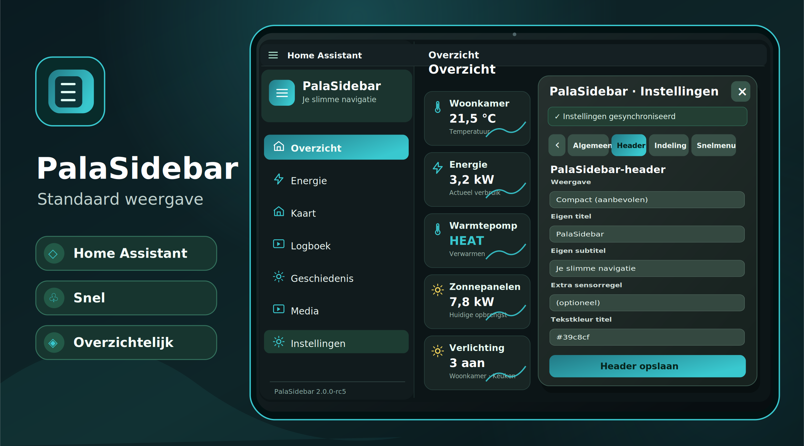
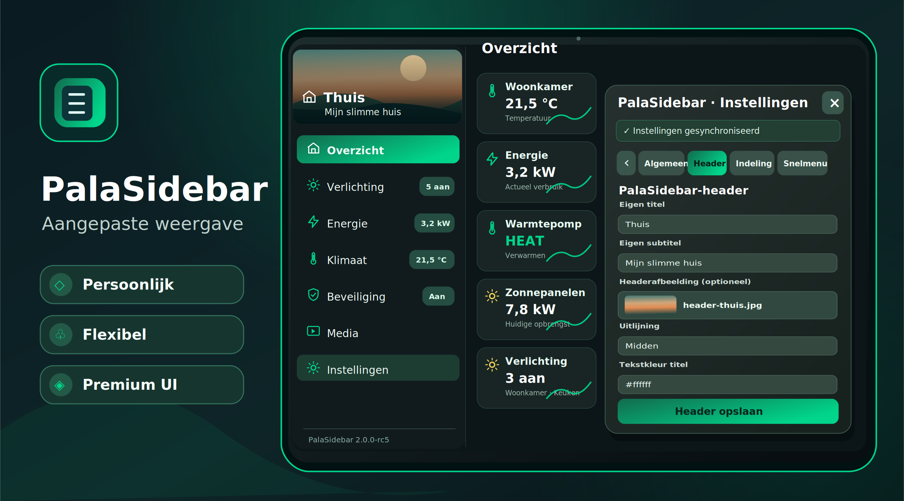
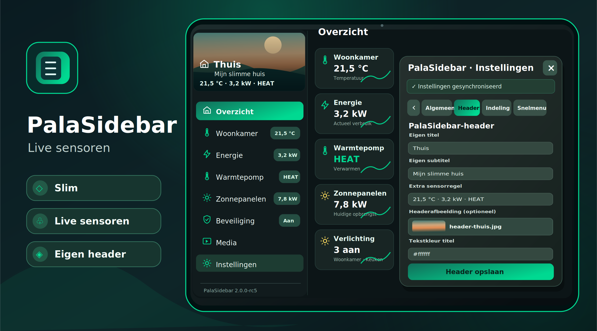

# PalaSidebar

**Een aanpasbare sidebar voor Home Assistant.** Met eigen menu's, slimme badges, thema's, snelkoppelingen en bediening voor desktop, telefoon en tablet.

**© 2026 Robin Bouwman** · Uitgebracht onder de [MIT-licentie](LICENSE) voor de oorspronkelijke PalaSidebar-bijdragen.

## PalaSidebar in beeld

Klik op een afbeelding om de **grote PNG-versie (2400 × 1333 pixels)** te openen. Op deze voorpagina blijven de voorbeelden compact. Voor onbeperkt scherp zoomen is er daarnaast een schaalbare SVG-versie.

<table>
  <tr>
    <th>Standaard</th>
    <th>Aangepast</th>
    <th>Live sensoren</th>
  </tr>
  <tr>
    <td align="center"><a href="https://github.com/OnlyRobin/PalaSideBar/blob/main/docs/images/palasidebar-standaard-groot.png"></a></td>
    <td align="center"><a href="https://github.com/OnlyRobin/PalaSideBar/blob/main/docs/images/palasidebar-aangepast-groot.png"></a></td>
    <td align="center"><a href="https://github.com/OnlyRobin/PalaSideBar/blob/main/docs/images/palasidebar-sensoren-groot.png"></a></td>
  </tr>
  <tr>
    <td align="center"><a href="docs/images/palasidebar-standaard-groot.png">Grote afbeelding</a> · <a href="docs/images/palasidebar-standaard-scherp.svg">Scherpe SVG</a></td>
    <td align="center"><a href="docs/images/palasidebar-aangepast-groot.png">Grote afbeelding</a> · <a href="docs/images/palasidebar-aangepast-scherp.svg">Scherpe SVG</a></td>
    <td align="center"><a href="docs/images/palasidebar-sensoren-groot.png">Grote afbeelding</a> · <a href="docs/images/palasidebar-sensoren-scherp.svg">Scherpe SVG</a></td>
  </tr>
</table>

*Illustratieve voorbeelden die nauw aansluiten bij PalaSidebar; het uiterlijk hangt af van je Home Assistant-thema, gekozen instellingen en beschikbare sensoren.*

## Huidige versies

| Versie | Betekenis |
| --- | --- |
| **[v2.0.0-rc5](https://github.com/OnlyRobin/PalaSideBar/releases/tag/v2.0.0-rc5)** | Nieuwste **release candidate**: eigen headerfoto, preview, bewerken en opslaan bij je account; HACS-testrelease |
| [v2.0.0-rc4](https://github.com/OnlyRobin/PalaSideBar/releases/tag/v2.0.0-rc4) | Vorige RC: kleurkiezers met HEX-code en live voorbeeld in Algemeen en Header |
| **[v2.0.0-beta8](https://github.com/OnlyRobin/PalaSideBar/releases/tag/v2.0.0-beta8)** | Nieuwste **beta** met de herstelde PalaSidebar UI, ondertitel en BEHEER-opties |
| [v2.0.0-beta7](https://github.com/OnlyRobin/PalaSideBar/releases/tag/v2.0.0-beta7) | Oudere beta, met drie inmiddels bekende fouten |
| **v2.0.0 Stable** | Nog **niet uitgebracht**; eerst testen op echte apparaten |

> **Belangrijk bij HACS-updates:** HACS heeft geen afzonderlijk beta- en RC-updatekanaal. Bij versievergelijking staat `2.0.0-rc5` boven `2.0.0-rc4` en doorgaans ook boven `2.0.0-beta8`. De automatisch aangeboden update hoeft dus niet uit dezelfde beta-reeks te komen. Kies **altijd bewust de gewenste versie** via HACS → PalaSidebar → Downloaden/Opnieuw downloaden → testversies. In `hacs.json` is de standaardbranch verborgen voor releasekeuzes.

## Mogelijkheden

- Zelf je sidebar indelen met menu's, categorieën, dashboards en favorieten.
- Dynamische sensorbadges met iconen, kleuren en actuele waarden.
- Home Assistant-entiteiten zoeken op naam of ID, met attribuutkeuze voor headerteksten en andere geschikte dynamische velden.
- Live Control Center voor snelle bediening en statusinformatie.
- Eigen thema's, Theme Studio en instellingen voor lettertypen en vormgeving.
- Snelmenu's via lang indrukken of rechtermuisknop, inclusief dashboardvolgorde.
- Mobiele bediening met swipebewegingen en ondersteuning voor de terugknop.
- Instellingen per Home Assistant-account, met import, export en herstelpunten.
- Performance Center met instellingen en informatie over prestaties.
- Automatische registratie van de frontend via de integratie; geen losse bestanden in `www` nodig.

## PalaSidebar installeren met HACS

1. Zorg dat **HACS** is geïnstalleerd in Home Assistant.
2. Open **HACS → drie puntjes → Aangepaste repositories** (of *Custom repositories*).
3. Voeg `https://github.com/OnlyRobin/PalaSideBar` toe als type **Integratie** (*Integration*).
4. Open **PalaSidebar**, schakel de weergave van testversies (*pre-releases / beta versions*) in en kies **v2.0.0-rc5** (nieuwste RC) of bewust een eerdere testversie.
5. Klik op **Downloaden** en herstart Home Assistant **volledig**.
6. Open **Instellingen → Apparaten en diensten → Integratie toevoegen** en voeg **PalaSidebar** toe, als deze nog niet is toegevoegd.
7. Verwijder eventuele oude, handmatig ingestelde PalaSidebar-JavaScript-resources om dubbel laden te voorkomen.

Alle integratiebestanden staan onder `custom_components/pala_sidebar`. De frontend wordt automatisch geregistreerd.

### Bijwerken vanaf een oudere of handmatige installatie

Maak **vóór** de update een Home Assistant-back-up en exporteer je PalaSidebar-instellingen. Bewaar daarnaast een kopie van `custom_components/pala_sidebar` en, indien aanwezig, je eigen `pala-sidebar-config.json` **buiten de integratiemap**. HACS mag bestanden in die map vervangen.

Open vervolgens **HACS → PalaSidebar → Download/Opnieuw downloaden**, kies de gewenste versie en herstart Home Assistant. Bestaande accountinstellingen gebruiken dezelfde opslaggegevens en oude vormgevingsinstellingen worden zo veel mogelijk overgenomen.

Verander de integratiedomeinnaam `pala_sidebar` niet: dit kan opgeslagen configuraties en resourcepaden onbruikbaar maken.

### Versie controleren

Open op je Home Assistant-adres het pad:

```text
/pala_sidebar/assets/pala-sidebar-version.json
```

Bij RC5 moet hier `2.0.0-rc5` staan nadat je deze release hebt gekozen; bij RC4 `2.0.0-rc4` en bij beta8 `2.0.0-beta8`. De versie staat ook onderaan PalaSidebar.

### Teruggaan naar een eerdere versie

Ga naar **HACS → PalaSidebar → Download/Opnieuw downloaden** en selecteer een nog beschikbare release (bijvoorbeeld beta8 of RC4). Herstart Home Assistant en herstel zo nodig je back-up. Een andere versie kiezen is geen vervanging voor een back-up van je instellingen.

## Wat is nieuw in RC5?

- **Header → Headerafbeelding**: kies direct op je telefoon, tablet of computer een JPG-, PNG- of WebP-afbeelding.
- PalaSidebar maakt er lokaal een kleine JPEG-headerstrook van en slaat die op **bij je Home Assistant-accountinstellingen**. Er is geen aparte `www`-map, externe uploadserver of opslagplugin nodig.
- **Direct voorbeeld**, uitsnede boven/midden/onder en een knop om de foto te verwijderen. De wijziging wordt pas definitief na **Header opslaan**.
- Je bestaande titel, subtitel, extra sensorregel en headerkleuren blijven werken. Ook de optie om de originele Home Assistant-sidebarheader te verbergen blijft behouden.
- Bestandslimiet: 4 MB voor de bron; de opgeslagen afbeelding is maximaal circa 100 kB in Base64 (verkleind).
- De gemaakte headerfoto wordt onderdeel van de accountinstellingen en dus ook van geëxporteerde instellingen en herstelpunten. Exporteer bij voorkeur voor de update je instellingen.

De automatische code-, HACS-, Hassfest- en Chromium-controles zijn geslaagd. Het blijft een testfunctie: controleer de bediening en synchronisatie ook op je eigen telefoon en tablet. Zie [RC5-release-opmerkingen](docs/RELEASE-v2.0.0-rc5.md).

## Wat is nieuw in RC4?

- **Algemeen → Kleuraccent**: een echte kleurenkiezer, bewerkbare HEX-code en een direct zichtbaar voorbeeld. Je accent wordt pas definitief toegepast na **Instellingen opslaan**.
- **Header**: visuele kleurkiezers voor de zeven kleuren van tekst, sensorregel, headerachtergrond, logo en klok.
- Bij de header kun je een eigen kleur verwijderen met **Themakleur gebruiken**. Een lege instelling blijft automatisch de vormgeving van het thema volgen.
- Ongeldige HEX-kleuren worden gemarkeerd en blokkeren het bewaren zonder bestaande kleuren te overschrijven.
- De reeds aanwezige kleurkiezers onder **Badges**, **Thema’s** en **PalaSidebar UI** blijven gewoon beschikbaar.

RC4 is gepubliceerd na geslaagde geautomatiseerde code-, Hassfest-, HACS- en Chromium-regressietests. Het blijft een testversie: controleer op je telefoon en tablet vooral de standaardkleur, kleurkeuze, HEX-invoer, opslaan en de keuze voor themakleuren. Zie [RC4-wijzigingen](docs/RELEASE-v2.0.0-rc4.md).

## Sensoren zoeken en attributen gebruiken

- In **Instellingen → Header** kun je een Home Assistant-sensor zoeken op naam of `entity_id`.
- Je kunt de gewone sensorwaarde of een beschikbaar attribuut (bijvoorbeeld `race_name` of `countdown`) kiezen.
- Met **Sensorwaarde invoegen** plaats je de gekozen waarde in titel, subtitel of extra sensorregel.
- De sensorwaarde wordt als voorbeeld getoond en kan na opslaan live in de header worden bijgewerkt.
- De entiteitenzoeker bij bestaande sensorvelden heeft een herkenbare zoekknop en betere suggesties.
- Bestaande sensortokens zoals `{sensor.woonkamer_temperatuur}` en `{sensor.f1#race_name}` blijven werken.

Deze functies zijn opgenomen in de huidige RC4 en RC5. Controleer sensorselectie en attribuutweergave ook op je eigen telefoon of tablet.

## Wat is verbeterd in beta8?

- Het lege tabblad **PalaSidebar UI** is hersteld.
- De standaardondertitel **Mijn Home Assistant** wordt weergegeven als er geen ondertitel is ingesteld.
- De standaardsectie **BEHEER** bevat meer opties, waaronder Apparaten, Entiteiten, Automatiseringen, Scripts, Helpers en Ontwikkelaarstools.
- De overbodige dubbele voorbeeldweergave tijdens het openen van UI-instellingen is verwijderd.

Zie de [beta8-release](https://github.com/OnlyRobin/PalaSideBar/releases/tag/v2.0.0-beta8) voor de volledige toelichting. Beta8 bevat de herstelde instellingenweergave, ondertitel en beheerschermen.

## Instellingen en compatibiliteit

Open het instellingenmenu van PalaSidebar om dashboards, badges, thema's, snelkoppelingen en **PalaSidebar UI** aan te passen. Eerdere vormgevingsinstellingen worden bij het inladen indien mogelijk overgenomen.

PalaSidebar is gebouwd als Home Assistant-customintegratie. Lokale logo's worden meegeleverd voor Home Assistant **2026.3 en nieuwer**. De werking op oudere versies en alle specifieke Android-apparaten is nog niet volledig bevestigd.

## Ontwikkeling en testen

- **`main`:** standaardbranch; we wijzigen die pas na controle.
- **`develop`:** ontwikkelbranch voor verbeteringen en regressietests.
- **`rc4-accent-color-picker`:** aparte testbranch voor RC4, zonder de eerdere releases aan te passen.
- **`rc5-header-image`:** aparte testbranch met headerafbeeldingen en README-voorbeelden.
- **`release/v2.0.0`:** voorbereiding van de toekomstige stabiele versie; nog niet gepubliceerd.
- **`release/v2.0.0-beta8`:** bronbranch waarmee beta8 is uitgebracht.

De technische bestanden staan in `custom_components/pala_sidebar`. Automatische controles draaien via GitHub Actions: codecontrole, Hassfest, HACS-validatie en browser-/touchregressietests.

Lees [Develop testen](docs/DEVELOP-TESTEN-NL.md) voor een veilige testopstelling of bekijk [GitHub Actions](https://github.com/OnlyRobin/PalaSideBar/actions). Meld fouten via [GitHub Issues](https://github.com/OnlyRobin/PalaSideBar/issues) met de versie, het toestel en de stappen om de fout te reproduceren. Deel geen wachtwoorden, tokens of privégegevens.

## Veiligheid en controle van de Git-geschiedenis

De openbare repository en alle tijdens de controle bereikbare branches, tags en historische commits zijn onderzocht op mogelijke geheimen en privégegevens. Daarbij zijn **geen herkenbare geheimen** gevonden. De scanner is getest met een fictieve sleutel, zodat een onbetrouwbaar 'groen' resultaat wordt voorkomen.

Lees het [volledige Nederlandstalige veiligheidsverslag](docs/VEILIGHEIDSCONTROLE-2026-10-31.md). De controles hebben bekende beperkingen en vormen geen zelfstandige juridische bevestiging van rechten op alle externe afbeeldingen.

## Licentie en auteursrecht

**© 2026 Robin Bouwman.** De eigen PalaSidebar-bijdragen vallen onder de [MIT-licentie](LICENSE). De rechten en naamsvermeldingen van eventueel materiaal van derden blijven behouden. Meer informatie staat in [Herkomst en licenties](PROVENANCE.md) en de [publicatiecontrole](docs/PUBLICATION-AUDIT-2026-10-31.md).

**Wat betekent MIT precies?** Lees de [Nederlandstalige uitleg over gebruik, auteursrecht en verspreiding](docs/LICENTIE-EN-GEBRUIK-NL.md). Hierin staat ook wat MIT toestaat bij forks en doorverkoop, en welke opties er zijn als toekomstige versies strengere voorwaarden zouden moeten krijgen. Deze uitleg voegt géén nieuwe beperkingen toe aan MIT.

**Voorstel voor toekomstige versies (niet van kracht):** er staat een [concept van de PalaSidebar Community License](docs/COMMUNITY-LICENSE-CONCEPT.md) klaar met gratis privé- en intern zakelijk gebruik, maar zonder ongeautoriseerde doorverkoop of herpublicatie. De [overstapchecklist](docs/COMMUNITY-LICENSE-OVERSTAP.md) beschrijft de noodzakelijke rechtencontrole, juridische toets en HACS-test. **De bestaande MIT-licentie en eerder uitgegeven MIT-rechten blijven ongewijzigd.** Dit voorstel maakt PalaSidebar nog niet minder open source.

De juridische tekst van het bestand `LICENSE` blijft bewust in de oorspronkelijke Engelstalige MIT-formulering. Technische bestandsnamen, programmeeridentificaties en vereiste Home Assistant/HACS-sleutels worden niet vertaald.
